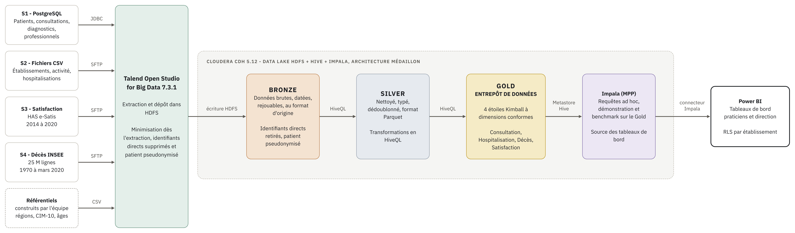

# Entrepôt de données décisionnel pour un CHU

*English summary: a data lake and BI project built by a team of three students. Heterogeneous hospital data (PostgreSQL tables, CSV and Excel files) is ingested with Talend into HDFS, refined through Bronze, Silver and Gold layers with Hive, queried with Impala and shown in a Power BI dashboard. The repository holds the code, the reports and the benchmark results, but no data. The documentation is in French.*

## Le projet

Un centre hospitalier universitaire (CHU) produit des données dans des formats très différents : une base de données, des fichiers CSV, des tableurs Excel. Ce projet les rassemble dans un entrepôt de données, les nettoie, protège l'identité des patients, puis les rend interrogeables depuis un tableau de bord. Ce tableau de bord s'adresse à deux profils, les praticiens et la direction, et répond à huit indicateurs, nommés B1 à B8 dans les rapports : part de chaque établissement et de chaque diagnostic dans les consultations, taux d'hospitalisation, séjours par diagnostic, hospitalisation par sexe et par âge, consultations par professionnel, décès par région, satisfaction par région.

C'est un projet pédagogique de quatrième année d'école d'ingénieurs, réalisé en groupe. Les données sources ont été fournies pour la formation, sont en partie synthétiques et ne sont pas redistribuées ici.

Le projet a été rendu en trois livrables : le livrable 1 (analyse des sources, modélisation et conception de la chaîne de traitement), le livrable 2 (implémentation et benchmark) et le livrable 3 (tableau de bord Power BI et restitution). Les documents du dépôt s'y réfèrent.

## Architecture

```
Sources ──> Bronze ──> Silver ──> Gold ──> Impala ──> Power BI
            Talend     Hive       Hive      requêtes    DirectQuery
            + HDFS     Parquet    étoile    SQL         sur des vues
```



Six sources alimentent l'entrepôt : des tables PostgreSQL (patients, consultations, professionnels), les établissements, les hospitalisations, la satisfaction des patients (e-Satis), les décès (fichiers INSEE) et le référentiel des régions (INSEE). Le lac de données, stocké sur HDFS, est organisé en trois couches :

- **Bronze** : les fichiers et la base sont copiés tels quels par des jobs Talend. Les identifiants des patients y sont déjà pseudonymisés.
- **Silver** : Hive donne un type à chaque colonne, nettoie et déduplique chaque source, puis les relie entre elles.
- **Gold** : Hive construit le schéma en étoile (des faits entourés de dimensions) que lisent les requêtes.
- **Impala et Power BI** : Impala répond aux requêtes sur le Gold, et Power BI lui envoie ses requêtes en DirectQuery, sans copier les données.

Quelques termes :

- **Lac de données** : un stockage de fichiers qui garde les données brutes et leurs versions nettoyées, sur plusieurs machines.
- **HDFS, Hive, Impala** : le système de fichiers distribué de Hadoop, et deux moteurs SQL qui lisent ces fichiers. Hive sert aux gros chargements, Impala aux requêtes qui doivent répondre vite.
- **Parquet** : un format de fichier organisé par colonnes, qui limite la quantité de données lues par une requête.
- **Pseudonymisation (HMAC)** : l'identifiant d'un patient est remplacé par un code que l'on ne peut pas retrouver sans une clé gardée à part.
- **DirectQuery** : Power BI ne copie pas les données, il envoie une requête SQL à chaque affichage.

## Ce que le projet met en œuvre

- Une chaîne de traitement en trois couches, avec des vérifications à chaque étape.
- Un benchmark qui mesure ce que rapporte chaque choix : modèle en étoile, format Parquet, partition des décès par année, moteur (Hive, Impala, PostgreSQL), index et volume de données.
- Un tableau de bord avec une sécurité par rôle, qui limite ce que voit chaque utilisateur à son périmètre (par exemple sa région), et un secret statistique qui masque les taux calculés sur moins de dix patients.

## Contenu du dépôt

| Dossier | Contenu |
|---|---|
| `docs/` | Rapports des livrables 1 et 2, dictionnaires de données, fiches des jobs, schémas (architecture, modèle dimensionnel, chaîne de traitement) |
| `etl/` | Scripts de chaque couche (`1_Bronze` à `4_Datamarts`) et benchmark (`5_Benchmark`). Le fichier [etl/README.md](etl/README.md) donne l'ordre de lancement |
| `powerbi/` | Rapport Power BI (`.pbit`), vues Impala qu'il lit et scripts qui l'ont généré. Voir [powerbi/README.md](powerbi/README.md) |

Les schémas de `docs/schemas/` viennent des rapports et du diaporama de soutenance, et [docs/schemas/README.md](docs/schemas/README.md) dit ce que montre chacun. Le schéma de la chaîne de traitement du livrable 1 prévoit encore une étape de datamarts PostgreSQL. Le livrable 3 l'a remplacée par une lecture directe du Gold par Impala, et `etl/4_Datamarts` garde les scripts de cette étape.

## Rejouer le projet

Le dépôt ne contient aucune donnée. Le code montre la démarche, mais il ne se rejoue pas sans les sources. Il faut aussi :

- une VM Cloudera QuickStart 5.12 (HDFS, Hive, Impala) ;
- Talend Open Studio for Big Data 7.3.1 ;
- PostgreSQL 14 ;
- Power BI Desktop.

L'ordre de lancement des scripts est dans [etl/README.md](etl/README.md).

## Ce qui n'est pas dans le dépôt

- Les données, même pseudonymisées : sources, Bronze, Silver, Gold, exports.
- La clé de pseudonymisation et les mots de passe. Les jobs Talend les lisent dans un fichier local qui n'est jamais partagé.
- Les supports du cours, les installateurs et la VM.
- Les aperçus Power BI déjà chargés (`.pbix`), qui contiennent des données.
