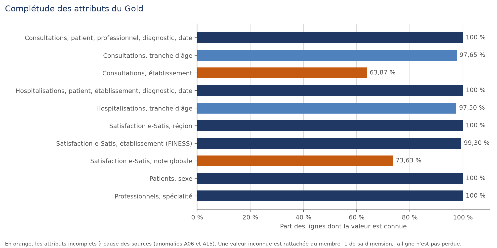
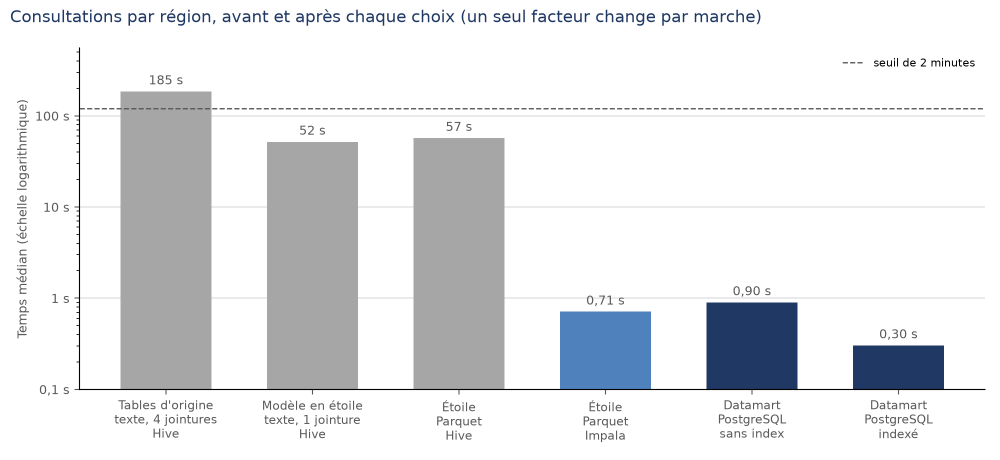
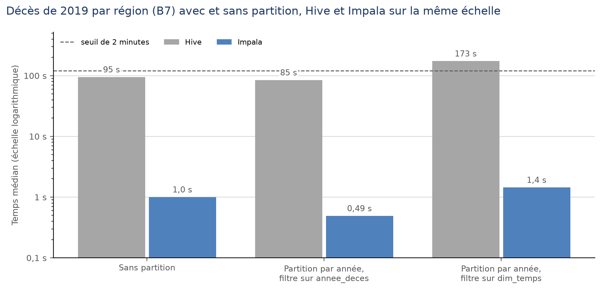
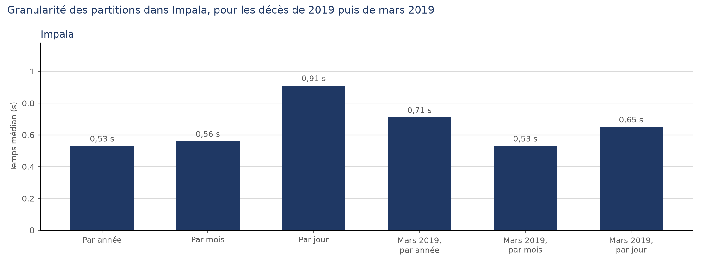
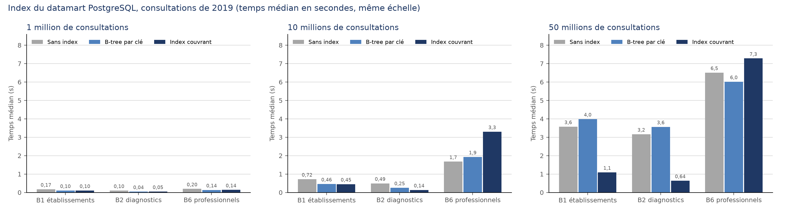
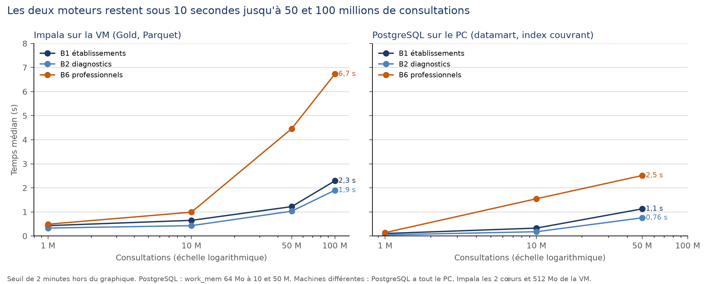
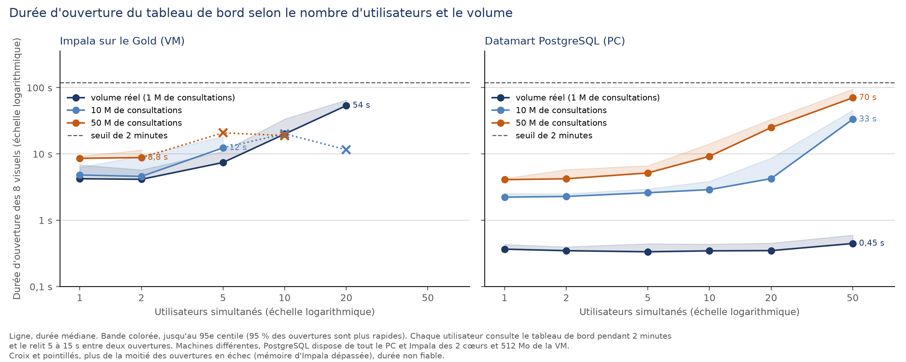

# Livrable 2, implémentation physique, qualité et performance

## Rappel de l'architecture

Pour que les tests qui suivent se lisent sans revenir au livrable 1, nous rappelons ici l'architecture que nous avons retenue, car chaque test a été conçu pour vérifier l'un de ses choix.

Les données des sources (consultations, hospitalisations, décès, enquêtes de satisfaction e-Satis et référentiels) sont lues par Talend, qui les pseudonymise, puis écrites dans le lac de données de la plateforme Cloudera, sur le système de fichiers distribué HDFS. Ce lac suit une architecture dite médaillon, organisée en trois couches successives. La couche Bronze garde les données brutes telles qu'elles sont arrivées, sans jamais les réécrire. La couche Silver contient les mêmes données une fois nettoyées, c'est-à-dire dédoublonnées, mises au bon format et débarrassées des lignes inexploitables. La couche Gold, enfin, réorganise ces données en un modèle en étoile, où une table de faits centrale (les consultations, par exemple) est reliée par une seule jointure à chacune de ses dimensions (le patient, le professionnel, l'établissement, la date).

Deux moteurs travaillent sur ce lac, avec des rôles distincts. Hive transforme les données d'une couche à l'autre, en traduisant chaque requête en une suite d'étapes MapReduce, une méthode robuste pour les gros traitements mais lente à démarrer. Impala interroge directement le Gold, sans passer par MapReduce, pour les questions ponctuelles et pour la démonstration. Le tableau de bord Power BI, lui, ne lit pas le lac de données. Il lit des datamarts, c'est-à-dire de petites bases PostgreSQL alimentées à partir du Gold, qui ne contiennent que les tables utiles aux indicateurs. Une règle de répartition complète ce dispositif, en prévoyant qu'au-delà de 50 millions de lignes une table de détail reste dans le Gold et que seul son agrégat part dans le datamart.

Le Gold est stocké au format Parquet, qui range les données colonne par colonne et les compresse, si bien qu'une requête ne lit que les colonnes dont elle a besoin. La table des décès, la plus volumineuse avec près de 25 millions de lignes, est en outre partitionnée par année, ce qui veut dire que chaque année est rangée dans son propre dossier et qu'une question portant sur 2019 n'ouvre que le dossier de 2019.

## Notre démarche de test

### La question de départ

Le livrable 1 justifiait chacun de ces choix par des arguments, mais aucun n'avait encore été mesuré. La question qui guide toute cette partie est donc simple à formuler. Notre architecture permet-elle au tableau de bord de répondre en moins de 2 minutes, et chacun de ses choix y contribue-t-il réellement ? Pour y répondre, nous avons traité chaque choix comme une hypothèse, que la mesure devait confirmer ou contredire, plutôt que de multiplier les tests au hasard.

### Les tests, dans l'ordre du parcours des données

Nous avons suivi le chemin d'une question, depuis les données brutes jusqu'à l'écran de l'utilisateur, en vérifiant à chaque étape le choix qui s'y applique. Chaque test répond à une question précise, rappelée ici avec l'endroit où se trouve son résultat :

1. **Le parcours complet.** Que rapporte chaque choix pris séparément ? La même question, le nombre de consultations par région, est posée d'abord sur les tables d'origine sous Hive, puis sur le modèle en étoile, en Parquet, sous Impala et enfin dans le datamart PostgreSQL. Ce test sert surtout à vérifier que Hive doit être réservé aux chargements et Impala aux requêtes (partie 4, premier graphique).
2. **La partition des décès.** Ranger les décès par année accélère-t-il les questions annuelles, et l'année est-elle le bon découpage ? La table est comparée sans partition, avec une partition par année, puis avec des partitions par mois et par jour (partie 4, partitionnement).
3. **La compression, les statistiques et les buckets.** Ces trois réglages du lac de données, que nous avions retenus ou envisagés sans les mesurer, apportent-ils réellement quelque chose ? Chacun est comparé à la même table sans ce réglage (partie 1).
4. **Les index des datamarts.** À partir de quel volume les index de PostgreSQL deviennent-ils utiles ? Le datamart est mesuré sans index, avec un index sur chaque clé, puis avec des index conçus pour nos requêtes, à 1, 10 et 50 millions de lignes (partie 4, indexation).
5. **Le volume.** Les requêtes restent-elles sous le seuil de 2 minutes quand les données grossissent, et la règle de répartition est-elle fondée ? Les consultations sont gonflées jusqu'à 100 millions de lignes dans Impala et 50 millions dans PostgreSQL (partie 4, volume).
6. **Plusieurs utilisateurs en même temps.** Le tableau de bord tient-il quand plusieurs dizaines de personnes le consultent en même temps, et faut-il vraiment le servir depuis PostgreSQL plutôt que depuis Impala ? Nous simulons de 1 à 50 utilisateurs qui ouvrent le tableau de bord, le lisent puis l'ouvrent de nouveau pendant 2 minutes, avec Impala, avec le datamart au volume réel et avec le datamart gonflé à 10 puis à 50 millions de consultations (partie 4, dernier graphique).
7. **Spark à la place de MapReduce.** La lenteur de Hive vient-elle bien du coût de démarrage de chaque étape MapReduce ? Ce test n'a pas pu aboutir sur notre machine, et nous expliquons pourquoi dans la conclusion.

### Les règles que nous nous sommes fixées

Pour qu'une mesure puisse réellement trancher, nous nous sommes imposé trois règles. La première consiste à ne changer qu'un seul facteur à la fois, sur la même question métier, afin que l'écart de temps observé ne puisse s'expliquer que par ce facteur. La deuxième consiste à vérifier que toutes les variantes d'une même question rendent exactement le même résultat, grâce à une empreinte calculée sur leur sortie, car comparer le temps de deux requêtes qui ne répondent pas la même chose n'aurait aucun sens. La troisième consiste à juger chaque résultat au regard du seuil de 2 minutes fixé à l'avance, qui apparaît en pointillés sur les graphiques.

### Comment lire les chiffres

Chaque temps donné dans ce document est la médiane de trois essais, mesurée après un premier essai mis à part, et s'exprime toujours en secondes. Une réserve pèse cependant sur l'ensemble des chiffres et doit être posée dès maintenant. Toutes les mesures ont été faites sur une seule machine, la machine virtuelle Cloudera QuickStart 5.12, qui ne dispose que de 2 cœurs et de 8 Go de mémoire, et sur le PostgreSQL 14 installé sur le PC qui héberge cette machine virtuelle. Les écarts entre deux variantes mesurées sur le même moteur sont donc fiables, alors que les temps absolus, et plus encore les comparaisons entre Impala et PostgreSQL, qui ne disposent pas des mêmes ressources, ne vaudraient pas tels quels sur un vrai cluster de plusieurs machines. Le lecteur doit donc retenir des résultats les rapports entre variantes, comme « deux fois plus rapide », plutôt que les valeurs elles-mêmes.

### Plan du document

Les parties 1 à 4 suivent l'ordre des attendus du livrable. La partie 1 présente la stratégie de partitionnement et d'indexation retenue pour chaque moteur, la partie 2 rend compte de la qualité des données intégrées, la partie 3 décrit les huit requêtes qui servent à toutes les mesures, et la partie 4 présente les temps mesurés avant et après chaque optimisation. La partie 5 rassemble enfin dans un récapitulatif le verdict de chaque test sur le choix d'architecture qu'il devait vérifier, puis les ajustements que nous en tirons.

## 1. Partitionnement et indexation

Les leviers d'optimisation ne sont pas les mêmes selon le moteur, et c'est pourquoi nous avons défini la stratégie couche par couche. Hive et Impala, dans les versions fournies par Cloudera 5.12, n'offrent pas d'index exploitables, si bien que tout le travail consiste à bien ranger les données, par le choix des partitions et du format de fichier, pour que chaque requête en lise le moins possible. PostgreSQL, qui porte les datamarts, s'optimise au contraire par ses index, qui jouent le rôle d'un sommaire permettant de retrouver des lignes sans parcourir toute la table, et par la mémoire qu'on lui accorde pour trier et regrouper.

### Lac de données (Hive et Impala)

La couche Bronze est partitionnée par date de chargement (colonne `load_date`, script `1_Bronze/bronze_tables.hql`), de sorte que chaque chargement est rangé dans son propre dossier, reste daté et n'est jamais réécrit, ce qui permet de rejouer la chaîne à partir de n'importe quel chargement passé. Les couches Silver et Gold sont stockées au format Parquet compressé en Snappy (scripts `2_Silver/silver_tables.hql` et `3_Gold/gold_tables.hql`). Dans le Gold, la table des décès est partitionnée par année de décès, parce que l'indicateur B7 et tous les indicateurs de décès portent sur une année, ce qui permet au moteur de n'ouvrir qu'un dossier sur 51. Après chaque chargement, la chaîne recalcule les statistiques de toutes les tables du Gold (commande `COMPUTE STATS`), c'est-à-dire le nombre de lignes et de valeurs distinctes de chaque colonne, dont Impala se sert pour choisir l'ordre et la méthode de ses jointures. Nous avons vérifié que ce calcul vaut la peine en lançant B1 et B6 sur des copies des tables privées de leurs statistiques, et les deux requêtes y sont environ 20 % plus lentes (0,65 seconde contre 0,52 pour B1, et 0,75 contre 0,60 pour B6), un gain modeste mais obtenu sans aucun coût pour l'utilisateur.

La table des décès est créée de la façon suivante dans le script du Gold.

```sql
CREATE TABLE gold.fait_deces (
    id_deces BIGINT, nb_deces INT, id_region INT, id_temps INT,
    id_execution STRING, date_chargement STRING, source STRING
)
PARTITIONED BY (annee_deces INT)
STORED AS PARQUET
LOCATION '/chu/gold/fait_deces';
```

Nous n'avons pas partitionné par région, parce que les questions métier filtrent d'abord sur une année avant de regrouper les résultats par région, et qu'une partition par région obligerait le moteur à ouvrir les 21 dossiers régionaux pour chaque question annuelle. Nous avons également rangé les décès par mois et par jour, afin de vérifier qu'une partition plus fine n'apportait rien de plus. Les résultats, présentés en partie 4, montrent que la partition par jour produit 18 352 fichiers et ralentit la requête annuelle.

Les buckets, qui découpent une table en un nombre fixe de fichiers selon la valeur d'une colonne pour faciliter les jointures, ont été essayés sur la jointure entre les consultations et les professionnels. Ils n'apportent rien dans notre cas, car la table des professionnels tient en mémoire, et une jointure simple, où Hive charge cette petite table en mémoire avant de parcourir les consultations, s'exécute plus vite que la jointure par buckets (58 s contre 74 s). Les buckets ne deviendraient utiles que si la plus petite table d'une jointure dépassait la mémoire disponible, ce qui n'arrive pour aucune de nos requêtes, et nous ne les avons donc pas gardés.

La compression Snappy mérite une remarque critique. Nous l'avions retenue parce que c'est le réglage le plus courant pour Parquet dans Hive et Impala, mais les mesures faites sur la table des décès ne la désignent pas comme le meilleur choix. Compressée en Gzip, la table n'occupe en effet que 52 Mo, contre 116 Mo en Snappy et 218 Mo sans compression, et les requêtes ne sont pas plus lentes, les écarts de temps mesurés dans Impala restant inférieurs à une demi-seconde, donc dans le bruit de mesure de la machine virtuelle. L'argument habituel en faveur de Snappy est la rapidité de l'écriture, que nous n'avons pas mesurée. Tant que ce point n'est pas vérifié, Gzip nous paraît préférable pour les tables volumineuses et rarement réécrites comme celle des décès.

### Datamarts (PostgreSQL)

Nous avons comparé deux stratégies d'indexation, la première posant un index sur chaque clé, comme on le ferait par réflexe, et la seconde posant des index conçus à partir des requêtes du tableau de bord. Un index couvrant contient, en plus de la colonne de recherche, toutes les colonnes dont la requête a besoin, ce qui permet à PostgreSQL de répondre en lisant l'index seul, sans ouvrir la table.

```sql
-- Clé de chaque dimension, l'équivalent d'une clé primaire
CREATE UNIQUE INDEX pk_dim_etablissement ON dm.dim_etablissement (id_etablissement);

-- Index couvrant, avec la colonne filtrée (la date) en tête puis les colonnes regroupées
CREATE INDEX cv_consult_temps ON fait_consultation (id_temps)
    INCLUDE (id_etablissement, id_diagnostic, id_professionnel);
```

La stratégie retenue découle directement des mesures présentées en partie 4. Au volume réel, qui est d'environ un million de consultations, nous n'indexons que les clés des dimensions, puisque toutes les questions obtiennent leur réponse en moins de 0,2 seconde avec ou sans index. L'index couvrant n'est ajouté qu'au-delà d'une dizaine de millions de lignes, car il coûte cher à entretenir. À 50 millions de lignes, il pèse 3,6 Go, soit plus que la table elle-même, et demande 6 minutes de reconstruction à chaque chargement. Nous avons enfin porté la mémoire de tri de PostgreSQL (paramètre `work_mem`) de 4 à 64 Mo, car pour la requête B6, qui trie un grand nombre de professionnels, ce réglage apporte davantage que n'importe quel index.

Nous n'avons pas partitionné les tables PostgreSQL, parce qu'à un million de lignes l'effet n'aurait pas été mesurable et que la règle de répartition maintient de toute façon dans le Gold les tables de détail qui atteindraient plusieurs dizaines de millions de lignes.

## 2. Qualité des données intégrées

Chaque couche dispose de son script de contrôle, qui compare des valeurs mesurées à des valeurs attendues et arrête la chaîne si un contrôle bloquant échoue. Tous ces contrôles sont passés lors du dernier chargement (exécution `GOLD_20261030_152336`), et les chiffres de cette partie en sont tirés, à l'exception de la complétude, que nous avons calculée sur les tables du Gold. L'organisation en couches est elle-même un choix d'architecture que la qualité permet de juger, puisque c'est en Silver, entre la donnée brute conservée intacte et la donnée modélisée, que les doublons et les lignes inexploitables sont retirés et comptés, sans que rien ne soit perdu dans le Bronze.

### Complétude par attribut

Lorsqu'une valeur est inconnue, la ligne n'est pas supprimée mais rattachée au membre « inconnu » de la dimension concernée (identifiant −1), de sorte que les totaux restent justes. La figure suivante donne, pour chaque attribut, la part des lignes dont la valeur est connue.



La plupart des attributs sont complets à 100 %, et la tranche d'âge ne manque que pour environ 2,5 % des consultations et des séjours, soit parce que l'âge du patient ne peut pas être calculé, soit, pour 62 séjours, parce que la date d'entrée précède la date de naissance (anomalie A17). Les établissements ont tous une région, à l'exception de 15 d'entre eux, sans commune ni code postal exploitable, qui sont rattachés à la région « Inconnu ».

Deux attributs restent nettement incomplets, et dans les deux cas le défaut vient des sources et non de nos traitements. La note globale e-Satis manque pour 26 % des lignes, parce qu'elle est absente dans les fichiers d'origine pour 25,5 % des lignes en 2019 et 27,2 % en 2020 (anomalie A15). Ces lignes sont gardées mais exclues du calcul des moyennes. Le point le plus faible est le rattachement des consultations à un établissement, qui ne dépasse pas 63,87 %, parce que plus d'un tiers des professionnels n'ont aucun établissement connu dans le fichier d'activité (anomalie A06). Aucune optimisation ne peut corriger ce défaut, et l'indicateur B1, qui donne la part de chaque établissement dans les consultations, doit donc afficher explicitement la part « établissement inconnu », faute de quoi il laisserait croire que les pourcentages portent sur l'ensemble des consultations.

### Cohérence référentielle

Le contrôle le plus délicat porte sur les codes FINESS, qui identifient les établissements de santé. Les fichiers e-Satis désignent l'établissement par son FINESS géographique, alors que notre référentiel l'identifie par un code précédé de la lettre « F ». Une fois ce préfixe ajouté (règle R16), 99,7 % des lignes e-Satis de 2020 retrouvent leur établissement, soit 1 146 sur 1 150, contre 99,0 % en 2019. Avec le FINESS juridique, que nous avions d'abord essayé, à peine la moitié des lignes trouvaient une correspondance. La région déclarée dans e-Satis concorde toujours avec celle de l'établissement retrouvé, sans un seul écart en 2019 comme en 2020.

Les autres liens sont contrôlés à chaque chargement. Aucune consultation n'est privée de son patient, de son professionnel ou de son diagnostic, aucun séjour n'est privé de son patient, de son établissement ou de son diagnostic, et aucun pseudonyme de patient n'est mal formé dans le Bronze. Parmi les consultations, 46,11 % sont rattachées à un établissement parce que leur professionnel n'en a qu'un seul, et 17,77 % le sont grâce à une règle de priorité qui départage les professionnels exerçant dans plusieurs établissements. Les consultations restantes concernent un professionnel sans organisation connue (8,00 %) ou absent du fichier d'activité (28,13 %). Pour les identifiants ADELI des professionnels, 36 172 codes à 8 chiffres ont été complétés d'un zéro initial (règle R12), et 2 codes abîmés par Excel dans la source ont été gardés tels quels, faute de pouvoir retrouver leur valeur d'origine.

### Doublons et lignes rejetées

La source des décès contenait 161 112 lignes strictement identiques en trop, dont 118 pour l'année 2019. Elles ont été retirées en Silver, et le contrôle ne trouve plus aucun doublon dans le Gold. Pour les patients, une seule paire de doublons probables a été détectée. Ces deux patients sont signalés par un indicateur mais n'ont pas été fusionnés, faute de preuve qu'il s'agit bien de la même personne. La recherche de doublons sur la clé métier des établissements, des professionnels et des séjours n'a rien trouvé.

Les décès inexploitables sont eux aussi écartés en Silver et comptés. Il s'agit de 646 décès dont la date est partielle ou illisible, de 7 169 décès antérieurs à 1970 et de 61 décès datés avant la naissance (règle R13). Le total tombe juste, puisque les décès écrits et les décès rejetés égalent ensemble les 24 927 096 décès distincts du Bronze. Ces rejets ne représentent que 0,03 % des décès, très en dessous du seuil de 5 % au-delà duquel chaque job s'arrête en échec (règle R18), et la chaîne est donc allée jusqu'au bout.

## 3. Jeu de requêtes de benchmark

Le benchmark repose sur les huit questions métier définies au livrable 1. Chacune est écrite en HiveQL pour Hive et Impala et en SQL pour PostgreSQL. Nous avons préféré ces requêtes à des requêtes artificielles, parce qu'elles sont celles que le tableau de bord enverra réellement, avec les mêmes filtres, les mêmes jointures et les mêmes regroupements. Nous n'avons pas branché Power BI pour ces mesures, car lancer directement les requêtes qu'il enverrait donne une estimation fidèle du temps d'affichage, sans le bruit de l'outil lui-même.

| Requête | Indicateur | Ce que la requête met à l'épreuve |
|---|---|---|
| B1 | Part de chaque établissement dans les consultations de 2019 | filtre sur la date, jointure, regroupement et calcul de part |
| B2 | Part de chaque diagnostic dans les consultations de 2019 | les mêmes opérations, sur une autre dimension |
| B3 | Taux global d'hospitalisation en 2019 | comptage de patients distincts |
| B4 | Séjours de 2019 par diagnostic | filtre, jointure et regroupement sur les séjours |
| B5 | Séjours et patients par sexe et tranche d'âge | deux jointures et un comptage distinct |
| B6 | Les 20 professionnels qui ont le plus consulté en 2019 | jointure sur un million de lignes, puis tri |
| B7 | Décès de 2019 par région | lecture d'une seule partition de la table des décès |
| B8 | Score e-Satis 2020 par région, pondéré par le nombre de réponses | moyenne pondérée |

Chaque requête est lancée quatre fois. Le premier essai, exécuté à froid, est mis à part, parce qu'il inclut le temps de chargement des fichiers en mémoire, et nous retenons la médiane des trois essais suivants, qui est moins sensible qu'une moyenne à un essai anormalement lent. Le contrôle des empreintes, qui vérifie que toutes les variantes d'une même question rendent le même résultat, a d'ailleurs révélé un écart sur B8. Impala tronque en effet la division de deux nombres décimaux et affiche 71,59 pour la Martinique, là où Hive et PostgreSQL donnent 71,60, un défaut qu'une conversion en nombre à virgule flottante (`DOUBLE`) dans la version Impala suffit à corriger.

Pour éprouver la règle de répartition, les consultations ont été recopiées jusqu'à 10, 50 et 100 millions de lignes. À chaque copie, l'établissement, le professionnel, le patient, le diagnostic et la date sont remplacés par d'autres valeurs réelles selon une formule fixe, ce qui garantit que PostgreSQL et Impala travaillent sur exactement les mêmes lignes. Des copies identiques auraient faussé le test, puisque Parquet les aurait compressées presque entièrement. Ces données gonflées ne servent bien sûr jamais au calcul des indicateurs.

## 4. Temps de réponse avant et après optimisation

Tous les graphiques expriment les temps en secondes, et les panneaux d'une même figure partagent la même échelle. Lorsque les valeurs s'étendent de quelques dixièmes de seconde à plusieurs minutes, nous avons utilisé une échelle logarithmique, sur laquelle chaque graduation correspond à un temps dix fois plus long que la précédente, afin que Hive et Impala restent lisibles sur le même axe. La ligne en pointillés marque le seuil de 2 minutes.

### Le parcours complet, des tables d'origine au datamart

Nous avons posé six fois la même question, celle du nombre de consultations par région, en ne changeant qu'un élément d'une marche à la suivante.



Sur les tables d'origine, avec quatre jointures, Hive met 185 secondes, ce qui dépasse le seuil de 2 minutes que nous nous étions fixé. Le passage au modèle en étoile, qui ramène la requête à une seule jointure, divise ce temps par 3,6 et le ramène à 52 secondes. Le format Parquet ne change rien à ce stade, avec 57 secondes, un écart qui reste dans le bruit de mesure, parce que les tables de cette question sont petites (16 Mo en texte) et que l'intérêt de Parquet n'apparaît que sur des tables volumineuses comme celle des décès, dont il divise par 18 les données lues. Le saut décisif vient du moteur, car Hive paie environ 40 secondes à chaque étape MapReduce, quelle que soit la taille des données, alors qu'Impala répond en 0,71 seconde. Dans le datamart PostgreSQL, la même question prend 0,90 seconde sans index et 0,30 seconde avec un index. L'index a de plus l'avantage de rendre le temps régulier, puisque les essais varient de 0,4 à 2,2 secondes sans lui et de 0,29 à 0,33 seconde avec lui.

Ce graphique justifie à lui seul la répartition des rôles entre les moteurs. Hive n'est pas fait pour répondre à un utilisateur, mais son coût fixe de 40 secondes par étape importe peu dans une chaîne de chargement qui dure de toute façon plusieurs dizaines de minutes, ce qui confirme qu'il a sa place pour transformer les données et non pour les interroger. Il faut en revanche reconnaître une limite, car le gain du modèle en étoile n'a été mesuré que dans Hive, où chaque jointure supprimée économise une étape MapReduce entière, et il serait sans doute bien plus faible dans Impala.

### Avant et après partitionnement

La figure suivante compare la requête B7 (décès de 2019 par région) sur la table des décès sans partition, puis partitionnée par année avec deux façons d'écrire le filtre sur l'année.



La partition divise par deux le temps d'Impala, qui passe de 1,0 à 0,49 seconde. Dans Hive, elle divise par 37 les données lues, qui tombent de 16 Mo à 0,4 Mo, mais le temps ne baisse que de 10 %, de 95 à 85 secondes, parce que le coût fixe des étapes MapReduce l'emporte largement sur la lecture. La troisième paire de barres est la plus instructive. Lorsque la requête filtre l'année dans la dimension du temps plutôt que sur la colonne de partition, le moteur ne sait plus quels dossiers ignorer, si bien qu'il lit toute la table, ajoute une jointure et devient plus lent que sans partition, avec 1,4 seconde dans Impala et 173 secondes dans Hive. La partition n'est donc utile que si les requêtes du tableau de bord filtrent directement sur la colonne `annee_deces`, et cette consigne d'écriture fait partie de notre choix au même titre que la partition elle-même.



Ranger les décès par mois ou par jour ne fait pas mieux que l'année. Pour la question annuelle, la partition par jour est 1,7 fois plus lente (0,91 seconde contre 0,53), parce qu'Impala doit ouvrir 365 petits fichiers au lieu d'un seul. La partition par mois n'aide que pour une question portant sur un mois précis, avec 0,53 seconde contre 0,71 avec la partition par année pour les décès de mars 2019. Comme aucun indicateur du livrable 1 ne porte sur un mois, la partition par année est la bonne granularité. Ces mesures n'ont pu être faites que dans Impala, car dans Hive la mémoire saturée de la machine virtuelle donnait pour une même requête des temps allant de 55 à 455 secondes, ce qui interdisait toute comparaison.

### Avant et après indexation

La figure suivante compare, pour trois requêtes portant sur les consultations, le datamart sans index, avec un index sur chaque clé et avec les index couvrants, à trois volumes différents.



Avec les trois volumes sur la même échelle, on voit d'emblée qu'au volume réel d'un million de consultations les index n'ont aucun effet perceptible pour l'utilisateur, toutes les requêtes répondant en moins de 0,2 seconde. À 50 millions de lignes, l'index couvrant divise le temps de B1 par 3, de 3,6 à 1,1 seconde, et celui de B2 par 5, de 3,2 à 0,64 seconde, parce que PostgreSQL lit alors l'index seul au lieu de parcourir les 3 Go de la table. L'index posé par réflexe sur chaque clé ne sert à rien à ce volume et rend même les requêtes un peu plus lentes. La requête retient en effet environ 12 % des lignes, et PostgreSQL préfère alors lire toute la table plutôt que d'aller et venir entre l'index et la table pour chacune d'elles. B6 n'est aidé par aucun index, puisque son temps se passe dans la jointure avec le million de professionnels et dans le tri. C'est la mémoire de tri qui l'accélère, avec un temps qui passe de 7,3 à 2,5 secondes à 50 millions de lignes lorsque `work_mem` est porté à 64 Mo.

### Quand le volume grossit



Jusqu'à 50 millions de lignes dans PostgreSQL et 100 millions dans Impala, toutes les requêtes restent sous 7 secondes, soit très loin du seuil de 2 minutes, et les deux moteurs rendent ligne pour ligne le même résultat. PostgreSQL se montre même plus rapide qu'Impala à 50 millions de lignes, mais cette comparaison est biaisée, puisque PostgreSQL dispose de tout le PC alors qu'Impala doit se contenter des 2 cœurs et des 512 Mo de mémoire que la machine virtuelle lui accorde.

Ce test ne valide donc la règle de répartition que sous une forme plus nuancée que celle du livrable 1. Ce n'est pas la vitesse de lecture qui limite le datamart, puisqu'il répond encore en quelques secondes à 50 millions de lignes, mais le coût de chaque chargement, qui oblige à copier 3 Go de données puis à reconstruire 3,6 Go d'index en 6 minutes, et, comme le montre le test suivant, sa capacité à servir plusieurs utilisateurs à la fois. La règle reste justifiée, car il n'y a aucun intérêt à payer ce coût pour des tables de détail qu'Impala lit déjà dans le Gold en moins de 7 secondes. Ce test seul ne permet pas de fixer le seuil à partir duquel la règle s'applique, et c'est le test suivant, avec plusieurs utilisateurs, qui nous conduit à proposer de l'abaisser.

### Plusieurs utilisateurs en même temps

Le dernier test vérifie le choix qui distingue le plus notre architecture, celui de servir le tableau de bord depuis PostgreSQL plutôt que directement depuis Impala. Une première version de ce test, où dix utilisateurs ouvraient le tableau de bord à la même seconde, nous a paru trop faible, car les clients d'Impala tournaient sur la machine virtuelle elle-même et lui prenaient une partie de ses deux cœurs, et parce qu'un seul clic simultané ne ressemble pas à l'usage réel d'un tableau de bord. Nous l'avons donc remplacée par une simulation plus proche de la réalité. Chaque utilisateur virtuel, lancé depuis le PC pour les deux moteurs, ouvre le tableau de bord, c'est-à-dire exécute les huit requêtes B1 à B8 à la suite comme les huit visuels, le lit pendant 5 à 15 secondes, puis l'ouvre de nouveau, et ainsi de suite pendant 2 minutes. Les utilisateurs arrivent de façon étalée, et nous avons répété l'expérience avec 1, 2, 5, 10, 20 puis 50 utilisateurs, sur six configurations, à savoir Impala sur le Gold et le datamart PostgreSQL, chacun à 1, 10 et 50 millions de consultations.



Le datamart PostgreSQL au volume réel ne ralentit pratiquement pas, puisque l'ouverture du tableau de bord prend 0,37 seconde pour un utilisateur et 0,45 seconde pour cinquante, et qu'il a servi 562 ouvertures en 2 minutes dans ce dernier cas sans le moindre échec. Impala, interrogé sur le Gold au même volume, part de beaucoup plus haut, avec 4,2 secondes pour un seul utilisateur, parce que chaque requête lui coûte entre 0,3 et 0,9 seconde de préparation et de coordination, même sur une table de quelques milliers de lignes comme celle des séjours, là où PostgreSQL répond en quelques millièmes de seconde. Surtout, Impala sature dès 5 à 10 utilisateurs, et il ne parvient plus à servir qu'une vingtaine d'ouvertures par minute, quel que soit le nombre de personnes qui attendent, si bien que la durée médiane d'ouverture atteint 20 secondes pour 10 utilisateurs et 54 secondes pour 20. Le biais de matériel joue ici à plein, puisque la machine virtuelle n'offre que deux cœurs à Impala, et un vrai cluster repousserait ce plafond. En l'état de nos mesures, rien ne justifie pourtant de brancher le tableau de bord directement sur Impala, ce qui confirme le choix de le réserver à l'exploration du Gold.

Les deux courbes du datamart gonflé à 10 puis à 50 millions de consultations apportent un argument que le test de volume ne donnait pas, car elles montrent que la capacité du datamart à servir plusieurs utilisateurs baisse à mesure que son volume augmente. À 10 millions de lignes, l'ouverture prend 2,2 secondes pour un utilisateur, reste sous 3 secondes jusqu'à 10 utilisateurs, monte à 4,3 secondes pour 20, puis s'effondre à 33 secondes pour 50, le datamart plafonnant alors autour de 80 ouvertures par minute. À 50 millions de lignes, il se comporte presque comme Impala, avec 4,1 secondes pour un utilisateur, une saturation dès 10 utilisateurs autour de 35 à 50 ouvertures par minute, et une durée médiane de 70 secondes pour 50 utilisateurs, l'ouverture la plus lente sur vingt dépassant même 95 secondes. Le seuil de 2 minutes reste tenu dans tous les cas, mais l'avantage du datamart s'efface à mesure que le détail s'y accumule.

Impala, de son côté, ne supporte pas mieux le volume, et il le supporte même plus mal. Avec un seul utilisateur, l'ouverture prend 4,8 secondes à 10 millions de lignes et 8,6 secondes à 50 millions, mais dès que plusieurs utilisateurs interrogent les grandes tables en même temps, Impala dépasse les 512 Mo de mémoire que la machine virtuelle lui accorde et abandonne des requêtes. À 10 millions de lignes, 31 ouvertures sur 40 échouent avec 10 utilisateurs, et à 50 millions de lignes, 19 sur 26 échouent dès 5 utilisateurs, puis toutes avec 20, alors que le datamart PostgreSQL n'a connu aucun échec dans aucune configuration. Ces échecs tiennent en grande partie à la mémoire très réduite de notre machine, et un vrai cluster les repousserait, mais ils montrent qu'Impala n'est pas fait pour servir à plusieurs dizaines d'utilisateurs des requêtes qui parcourent des dizaines de millions de lignes.

Ce résultat donne enfin à la règle de répartition une justification mesurée, puisque garder le détail volumineux dans le Gold et n'envoyer que des agrégats dans le datamart est précisément ce qui permet à celui-ci de rester rapide quand les utilisateurs se multiplient. Il en précise aussi le sens, car le détail laissé dans le Gold ne doit pas être servi au tableau de bord par Impala, qui sature encore plus vite que le datamart, mais réservé à l'exploration ponctuelle par quelques analystes, le tableau de bord ne lisant que des agrégats pour les tables qui dépassent le seuil. Il conduit aussi à remettre en cause la valeur de 50 millions de lignes retenue au livrable 1, qui nous paraît désormais trop élevée. Un datamart de 50 millions de lignes ne sert confortablement qu'une dizaine d'utilisateurs simultanés, alors qu'à 10 millions il en sert une vingtaine sans dépasser 5 secondes, ce qui plaide pour un seuil de l'ordre de 10 millions de lignes. La requête B6, qui classe les professionnels, explique à elle seule les trois quarts du temps d'ouverture à 10 millions de lignes (1,7 seconde sur 2,2), et une table agrégée par professionnel et par année dans le datamart l'allégerait sans doute fortement, mais nous ne l'avons pas mesuré. Le nombre réel d'utilisateurs simultanés du tableau de bord reste enfin à estimer avec le CHU, car c'est de lui que dépend le choix final du seuil.

## 5. Récapitulatif et conclusion

Le tableau suivant reprend chaque choix d'architecture et ce que les tests en disent, en distinguant les choix que les mesures confirment nettement, ceux qu'elles ne confirment qu'en partie, et ceux qu'elles ne permettent pas de vérifier.

| Choix d'architecture | Ce que nous avons mesuré | Verdict |
|---|---|---|
| Hive pour les chargements, Impala pour les requêtes | Sur la même table, Impala répond 80 fois plus vite que Hive (0,71 s contre 57 s) | confirmé |
| Gold en modèle en étoile | Une seule jointure au lieu de quatre rend la requête 3,6 fois plus rapide dans Hive | confirmé dans Hive, non mesuré dans Impala |
| Format Parquet | Aucun gain sur une petite table, mais 18 fois moins de données lues sur les décès | confirmé pour les grosses tables |
| Compression Snappy | Place divisée par deux, alors que Gzip la divise par quatre sans ralentir les requêtes | à revoir |
| Partition des décès par année | Requête deux fois plus rapide dans Impala, à condition de filtrer sur la colonne de partition | confirmé, sous condition |
| Datamarts PostgreSQL pour le tableau de bord | Ouverture en 0,45 s pour 50 utilisateurs au volume réel, alors qu'Impala sature dès 5 à 10 utilisateurs (54 s pour 20), et voit la plupart de ses ouvertures échouer à 10 et 50 millions de lignes | confirmé, avec un biais de matériel |
| Index des datamarts | Aucun effet au volume réel, temps divisé par 3 à 5 à 50 millions de lignes | utile à grand volume seulement |
| Règle de répartition | Les requêtes restent sous 7 s jusqu'à 50 et 100 millions de lignes, mais un datamart sert une vingtaine d'utilisateurs à 10 millions de lignes et une dizaine seulement à 50 millions, et coûte cher à recharger, et Impala ne peut pas prendre le relais pour plusieurs utilisateurs | justifiée, seuil de 50 millions à abaisser vers 10 millions, détail du Gold réservé à l'exploration |
| Statistiques recalculées après chaque chargement | Environ 20 % de gain dans Impala | confirmé |
| Buckets | Plus lents qu'une jointure simple (74 s contre 58 s) | écarté |
| Spark à la place de MapReduce | Les sessions Spark n'ont jamais démarré, faute de mémoire sur la machine virtuelle | non vérifié |

Dans l'ensemble, les mesures valident la séparation des rôles qui structure notre architecture, avec Hive pour transformer, Impala pour explorer le Gold et PostgreSQL pour servir le tableau de bord, puisqu'à chaque fois le moteur choisi est celui qui tient le mieux l'usage qu'on lui confie. Le modèle en étoile, le format Parquet et la partition des décès par année se justifient eux aussi par la mesure, à condition pour la partition que les requêtes filtrent sur la bonne colonne. Les tests obligent en revanche à corriger deux points que nous avions tenus pour acquis, la compression Snappy, que rien dans nos chiffres ne désigne comme le meilleur choix, et les index des datamarts, qui n'apportent rien tant que les tables gardent leur volume actuel.

Nous en tirons quatre ajustements. Nous proposons de remplacer Snappy par Gzip pour la table des décès si un test d'écriture ne contredit pas ce choix, de n'indexer que les clés des datamarts tant que leur volume reste proche du volume actuel, en gardant l'index couvrant pour le jour où il dépasserait une dizaine de millions de lignes, et de porter `work_mem` à 64 Mo. Nous proposons enfin d'abaisser le seuil de la règle de répartition de 50 à environ 10 millions de lignes, puisqu'au-delà le datamart coûte cher à recharger et perd sa capacité à servir plusieurs utilisateurs à la fois, une proposition que l'équipe devra confirmer une fois connu le nombre réel d'utilisateurs du tableau de bord.

Deux limites doivent rester en tête à la lecture de ces résultats. Tout a tourné sur une seule machine, sans cluster, ce qui rend fiables les écarts entre variantes d'un même moteur mais pas les temps absolus, ni les comparaisons entre des moteurs installés sur des ressources différentes. L'essai de Hive sur Spark, qui aurait permis de vérifier directement que les 40 secondes par étape viennent de MapReduce, n'a par ailleurs pas pu démarrer, le gestionnaire de ressources YARN n'ayant jamais attribué de mémoire aux sessions Spark, très probablement parce que celle de la machine virtuelle était déjà saturée. Ce coût fixe est donc établi par la lecture des plans d'exécution et non par une comparaison directe.
