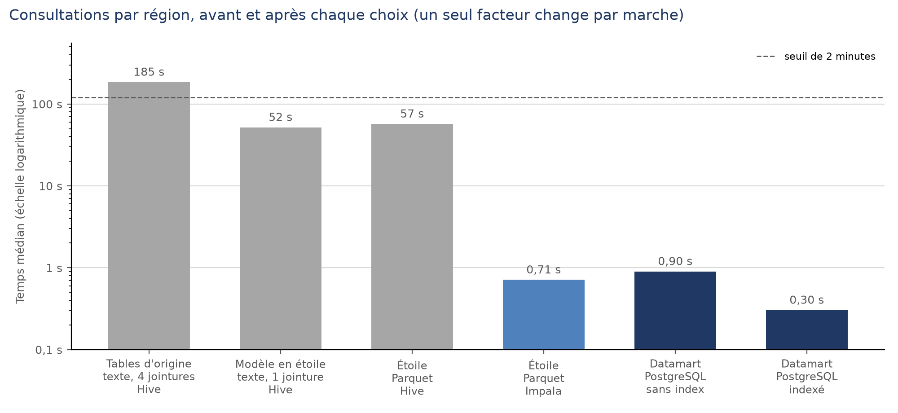
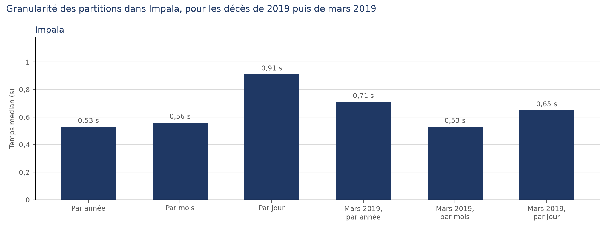
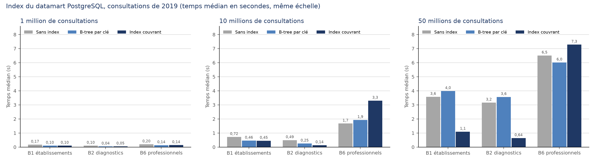
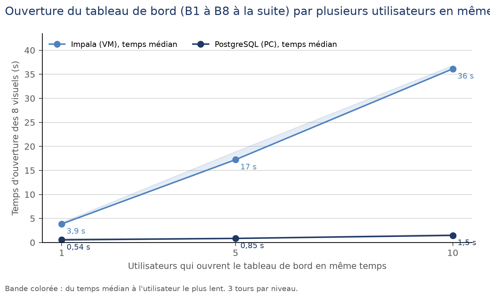
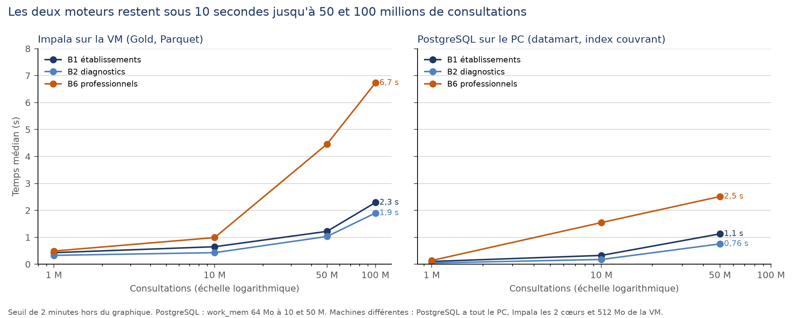
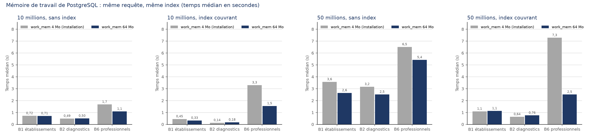

# Benchmark des performances

## Ce que nous voulions savoir

Le benchmark répond à quatre questions, chacune liée à un choix du livrable 1.

1. Nos choix de modèle physique (modèle en étoile, Parquet, partitionnement, index) font-ils vraiment gagner du temps ?
2. Le tableau de bord répond-il en moins de 2 minutes, y compris quand plusieurs personnes l'ouvrent en même temps ?
3. Que se passe-t-il quand le volume grossit, et où placer la limite entre le Gold et les datamarts ?
4. Quels réglages ne changent presque rien, ou coûtent plus qu'ils ne rapportent ?

Pour chaque question, nous posons la même requête de plusieurs façons, en ne changeant qu'un seul élément à la fois. L'écart de temps vient alors de cet élément, et de lui seul.

### Conditions de mesure

Tout tourne sur **une seule machine**, ce qui pèse sur la lecture des chiffres.

- La VM Cloudera QuickStart 5.12 (Hive 1.1, Impala 2.9) dispose de 2 cœurs et de 8 Go de mémoire, dont 512 Mo pour Impala. Il n'y a donc qu'un seul nœud : ni Hive ni Impala ne répartissent le travail entre plusieurs machines.
- PostgreSQL 14, qui porte les datamarts, tourne sur le PC qui héberge la VM, avec les réglages d'installation (sauf pour le test de `work_mem`).
- Avec nos données (1 million de consultations, 25 millions de décès, quelques centaines de Mo en Parquet), une seule machine suffit pour comparer des variantes entre elles. Les **écarts relatifs** sont donc fiables. Les **temps absolus**, eux, ne valent que pour cette machine. Un vrai cluster ajouterait du parallélisme, mais aussi des échanges réseau, et le coût de démarrage de MapReduce resterait le même.

Chaque test est lancé 4 fois. Le premier essai, à froid, est donné à part, et nous gardons la médiane des essais 2 à 4. Nous vérifions aussi que toutes les variantes d'un même test rendent exactement le même résultat, grâce à une empreinte calculée sur la sortie triée. Une variante plus rapide qui rendrait un autre résultat ne prouverait rien. Le seuil de **2 minutes** tracé sur les graphiques est le temps de réponse maximal que nous nous sommes fixé pour une question du tableau de bord.

Les volumes de 10, 50 et 100 millions de consultations sont **artificiels** : chaque consultation est recopiée, et à chaque copie l'établissement, le professionnel, le patient, le diagnostic et la date sont remplacés par d'autres valeurs réelles. Cette règle de calcul est la même dans Impala et dans PostgreSQL, si bien que les deux moteurs travaillent sur exactement les mêmes tables. Nous avons vérifié que les deux moteurs rendent ligne pour ligne le même résultat pour B1, B2 et B6, à 10 comme à 50 millions de lignes. Ces données ne servent jamais aux indicateurs.

## A. Nos choix de modèle physique paient-ils ?

### Le parcours complet, marche par marche

La question « combien de consultations par région ? » a été posée six fois. Entre deux marches, un seul élément change.

| Marche | Ce qui change | Temps médian | Gain |
|---|---|---|---|
| Tables d'origine du Bronze, texte, 4 jointures, Hive | point de départ | 185 s | |
| Modèle en étoile, texte, 1 jointure, Hive | le modèle | 52 s | 3,6 fois plus rapide |
| Modèle en étoile, Parquet, Hive | le format | 57 s | aucun |
| Modèle en étoile, Parquet, Impala | le moteur | 0,71 s | 80 fois plus rapide |
| Datamart PostgreSQL, sans index | la base | 0,90 s | comparable à Impala |
| Datamart PostgreSQL, avec index | les index | 0,30 s | 3 fois plus rapide |

Le modèle en étoile fait gagner un facteur 3,6. Il remplace 4 jointures par une seule, et Hive passe de 6 étapes MapReduce à 2.

Le format ne change rien ici, car les tables sont trop petites (16 Mo en texte, 6 Mo en Parquet) pour que la lecture compte. Parquet paie en revanche dès que les données grossissent. Sur les 25 millions de décès, Hive lit 18 fois moins de données en Parquet qu'en texte (65 Mo au lieu de 1 179 Mo) et répond 1,6 fois plus vite (105 s au lieu de 169 s). Impala, lui, va 3 fois plus vite (0,4 s au lieu de 1,1 s).

Le changement de moteur est de loin le plus important. Hive découpe chaque requête en étapes MapReduce, et chaque étape coûte environ 40 secondes sur la VM, quelle que soit la quantité de données : il faut réserver de la mémoire auprès de YARN, démarrer des programmes Java et écrire chaque résultat intermédiaire sur le disque. Impala n'a pas ce coût, car ses services tournent en permanence. Sur les 8 questions métier, Hive met de 82 à 128 secondes, et Impala de 0,3 à 0,8 seconde.

| Étapes MapReduce dans le plan | Exemples | Temps dans Hive |
|---|---|---|
| 1 | B7 lu dans une table d'agrégat | 45 s |
| 2 | B4, B7, modèle en étoile | 52 à 83 s |
| 3 | B1, B2, B3, B5, B6, B8 | 118 à 128 s |
| 6 | tables d'origine, 4 jointures | 185 s |

Les deux dernières marches portent sur les mêmes tables, copiées dans le datamart PostgreSQL, et rendent le même résultat que Hive et Impala. Sans index, PostgreSQL répond en 0,9 seconde en médiane, mais ses temps varient de 0,4 à 2,2 secondes d'un essai à l'autre (8 essais). Avec un index sur la clé de jointure, il répond en 0,30 seconde, et toujours entre 0,29 et 0,33 seconde. L'index rend donc la requête à la fois plus rapide et plus régulière, ce qui compte pour un tableau de bord.

**Décision.** Le Gold est en étoile et en Parquet. Hive sert aux chargements de nuit, où quelques minutes ne gênent personne, et jamais aux requêtes du tableau de bord.

### Partitionnement

La table des décès est partitionnée par année : chaque année est rangée dans son propre dossier. Une requête qui filtre sur la colonne `annee_deces` ne lit que le dossier de 2019.

| Variante de B7 (décès de 2019 par région) | Hive | Données lues par Hive | Impala |
|---|---|---|---|
| Table sans partition | 95 s | 16 Mo | 1,0 s |
| Partition par année, filtre sur `annee_deces` | 85 s | 0,4 Mo | 0,5 s |
| Partition par année, filtre sur l'année de `dim_temps` | 173 s | 28 Mo | 1,4 s |

La partition divise par 37 les données lues par Hive et par 2 le temps d'Impala. Dans Hive, le temps ne baisse pourtant que de 10 %, car le coût fixe des étapes domine. La troisième ligne montre le piège à éviter : si l'année est filtrée dans la dimension du temps, le moteur ne sait plus quel dossier ignorer. Il lit tout, fait une jointure de plus, et devient plus lent que sans partition. Les requêtes du tableau de bord doivent donc filtrer directement sur `annee_deces`.

Nous avons aussi rangé les mêmes décès par mois, puis par jour, pour voir si un partitionnement plus fin aide encore.

| Rangement | Fichiers sur le disque | Décès de 2019 par région | Décès de mars 2019 par région |
|---|---|---|---|
| Par année | 51 | 0,53 s | 0,71 s |
| Par mois | 603 | 0,56 s | 0,53 s |
| Par jour | 18 352 | 0,91 s | 0,65 s |

Pour la question annuelle, le rangement par jour est 1,7 fois plus lent : Impala doit ouvrir 365 petits fichiers au lieu d'un seul. Pour une question sur un seul mois, le rangement par mois est le plus rapide, car il ne lit que le dossier de mars. Le rangement par jour reste plus lent, pour la même raison des petits fichiers. On peut donc trop partitionner : la bonne granularité est celle des questions posées.

Ces mesures n'ont été faites que dans Impala. Dans Hive, la mémoire de la VM était saturée, et la même requête prenait de 55 à 455 secondes d'un essai à l'autre. Ces essais, inexploitables pour comparer les rangements, ont été arrêtés.

**Décision.** Nous gardons la partition par année, qui correspond aux questions posées (B7 et les indicateurs annuels). Un rangement par mois ne se justifierait que si le tableau de bord affichait surtout des chiffres mensuels.

### Index du datamart

Les index ne concernent que PostgreSQL : Hive 1.1 et Impala 2.9 n'en ont pas. Nous avons comparé trois états du datamart.

- **Sans index** : PostgreSQL lit toute la table.
- **B-tree par clé** : un index sur chaque identifiant de dimension et sur chaque clé étrangère des faits. C'est ce qu'on pose « par réflexe ».
- **Index couvrant** : un index qui commence par la date (la colonne filtrée) et contient aussi les colonnes regroupées. PostgreSQL peut alors répondre en lisant l'index seul, sans ouvrir la table.

| Volume | Question | Sans index | B-tree par clé | Index couvrant |
|---|---|---|---|---|
| 1 million (volume réel) | B1 établissements | 0,17 s | 0,10 s | 0,10 s |
| 1 million | B2 diagnostics | 0,10 s | 0,04 s | 0,05 s |
| 1 million | B6 professionnels | 0,20 s | 0,14 s | 0,14 s |
| 1 million | B3, B4, B5, B7, B8 | moins de 0,02 s | moins de 0,02 s | moins de 0,02 s |
| 10 millions | B1 | 0,72 s | 0,46 s | 0,45 s |
| 10 millions | B2 | 0,49 s | 0,25 s | 0,14 s |
| 50 millions | B1 | 3,6 s | 4,0 s | 1,1 s |
| 50 millions | B2 | 3,2 s | 3,6 s | 0,64 s |
| 50 millions | B6 | 6,5 s | 6,0 s | 7,3 s |

Au volume réel, les index ne changent rien d'utile : tout répond en moins de 0,2 seconde sans aucun index. À 50 millions de lignes, l'index couvrant divise le temps de B1 par 3 et celui de B2 par 5. Le plan d'exécution le confirme : la lecture des consultations passe d'un parcours complet de la table à une lecture de l'index seul. Le B-tree « par réflexe » ne sert à rien à ce volume. Pour environ 12 % de lignes retenues (l'année 2019), PostgreSQL préfère lire toute la table plutôt que de sauter de l'index à la table pour chaque ligne.

B6 n'est aidé par aucun index. Son temps vient de la jointure avec le million de professionnels et du tri qui suit, pas de la lecture. Nous y revenons dans la partie D.

Les index ont aussi un coût :

| Volume | État | Création | Place des index | Table des consultations |
|---|---|---|---|---|
| 10 millions | B-tree par clé | 33 s | 447 Mo | 619 Mo |
| 10 millions | Index couvrant | 63 s | 803 Mo | 619 Mo |
| 50 millions | B-tree par clé | 3 min 49 | 1,9 Go | 3,1 Go |
| 50 millions | Index couvrant | 5 min 54 | 3,6 Go | 3,1 Go |

À 50 millions de lignes, les index pèsent plus lourd que la table et prennent 6 minutes à recréer à chaque chargement.

**Décision.** Au volume actuel, le datamart n'a besoin que des clés de ses dimensions. L'index couvrant sur la date des faits de consultation ne sera ajouté que si le volume dépasse une dizaine de millions de lignes, et seulement pour les requêtes qui filtrent sur la date.

## B. Le tableau de bord répond-il assez vite ?

Power BI lit les datamarts PostgreSQL. Faute de Power BI installé, nous avons lancé les requêtes qu'il enverrait (une jointure entre un fait et une dimension, un filtre, un regroupement). Les 8 questions répondent en moins de 0,2 seconde au volume réel, et en moins de 8 secondes même à 50 millions de consultations, très loin du seuil de 2 minutes.

Un tableau de bord est cependant ouvert par plusieurs personnes à la fois. Nous avons simulé jusqu'à 10 utilisateurs qui ouvrent le tableau de bord en même temps, c'est-à-dire qui lancent chacun les 8 questions à la suite.

| Moteur | Utilisateurs simultanés | Ouverture du tableau de bord (médiane) | Utilisateur le plus lent |
|---|---|---|---|
| PostgreSQL | 1 | 0,54 s | 0,84 s |
| PostgreSQL | 5 | 0,85 s | 0,94 s |
| PostgreSQL | 10 | 1,5 s | 1,7 s |
| Impala | 1 | 3,9 s | 4,2 s |
| Impala | 5 | 17 s | 19 s |
| Impala | 10 | 36 s | 37 s |

Avec PostgreSQL, 10 utilisateurs font tripler le temps d'ouverture, qui reste sous 2 secondes. Avec Impala, le temps grandit presque en proportion du nombre d'utilisateurs : 3,9 secondes pour un seul, 36 secondes pour dix. Sur la VM, Impala n'a que 2 cœurs, si bien que les requêtes des différents utilisateurs attendent leur tour. Les 36 secondes restent sous le seuil de 2 minutes, mais l'attente se sentirait. Sur un vrai cluster, chaque nœud ajouterait des cœurs, et ce résultat serait meilleur.

Un premier passage de ce test a été écarté. Trois sessions de l'essai Hive sur Spark (partie D) étaient restées bloquées dans YARN et ralentissaient la VM : un utilisateur seul mettait alors 6,8 à 14 secondes. Après leur arrêt, les 8 questions ont retrouvé leurs temps habituels, et le test a été refait.

**Décision.** Le datamart PostgreSQL sert le tableau de bord, y compris pour plusieurs utilisateurs à la fois. Impala reste réservé aux analyses ponctuelles sur le Gold et aux très gros volumes.

## C. Que se passe-t-il quand le volume grossit ?

Le livrable 1 prévoyait une règle de répartition : au-delà de 50 millions de lignes, une table de détail reste dans le Gold et seul son agrégat part dans le datamart. Nous avons mesuré les mêmes questions dans Impala (sur le Gold) et dans PostgreSQL (sur le datamart), jusqu'à 100 millions de consultations pour Impala et 50 millions pour PostgreSQL.

| Question | Moteur | 1 M | 10 M | 50 M | 100 M |
|---|---|---|---|---|---|
| B1 établissements | Impala | 0,43 s | 0,65 s | 1,2 s | 2,3 s |
| B1 | PostgreSQL | 0,10 s | 0,33 s | 1,1 s | |
| B2 diagnostics | Impala | 0,33 s | 0,43 s | 1,0 s | 1,9 s |
| B2 | PostgreSQL | 0,05 s | 0,18 s | 0,76 s | |
| B6 professionnels | Impala | 0,49 s | 0,99 s | 4,5 s | 6,7 s |
| B6 | PostgreSQL | 0,14 s | 1,5 s | 2,5 s | |

PostgreSQL est mesuré avec l'index couvrant et, à partir de 10 millions, avec 64 Mo de `work_mem` (voir partie D).

Les deux moteurs restent sous 10 secondes. B1 et B2 grandissent lentement, car ils comptent d'abord les consultations puis ne joignent que quelques milliers de lignes. B6 grandit plus vite, car il doit joindre chaque consultation à son professionnel avant de compter.

Ce premier test de volume corrige un défaut de notre ancienne mesure. Les copies étaient identiques et se suivaient, si bien que Parquet les compressait presque entièrement : 100 millions de lignes ne pesaient qu'une douzaine de Mo. Avec des copies variées, la table de 100 millions pèse 1,7 Go, ce qui est réaliste.

Ce résultat change la justification de la règle des 50 millions. PostgreSQL reste rapide à 50 millions de lignes, plus rapide même qu'Impala sur cette machine. Il faut toutefois le lire avec prudence, car PostgreSQL dispose de tout le PC alors qu'Impala n'a que les 2 cœurs et 512 Mo de la VM. La limite ne vient donc pas de la vitesse de lecture. Elle vient de ce qu'il faut payer à chaque chargement : copier 50 millions de lignes vers PostgreSQL (3,1 Go), puis recréer 3,6 Go d'index en 6 minutes. Impala, lui, lit le Gold sur place, sans copie ni index.

**Décision.** Nous gardons la règle de répartition, mais avec une justification mesurée. Jusqu'à quelques dizaines de millions de lignes, le détail peut aller dans le datamart. Au-delà, le coût de la copie et des index l'emporte, et le détail reste dans le Gold, interrogé par Impala, seul l'agrégat partant dans le datamart. [à trancher avec l'équipe : garder 50 millions comme seuil, ou le fixer plus bas.]

## D. Ce qui change peu, ou coûte plus que ça ne rapporte

### Mémoire de travail de PostgreSQL

À l'installation, PostgreSQL ne donne que 4 Mo de mémoire à chaque tri ou regroupement (`work_mem`). Au-delà, il écrit sur le disque.

| Question, avec index couvrant | 4 Mo (installation) | 64 Mo |
|---|---|---|
| B6, 10 millions | 3,3 s | 1,5 s |
| B6, 50 millions | 7,3 s | 2,5 s |
| B1 et B2, 10 et 50 millions | de 0,14 à 1,1 s | de 0,18 à 1,1 s |

Pour B6, augmenter `work_mem` divise le temps par 3, ce qu'aucun index n'avait obtenu. B1 et B2, qui regroupent peu de lignes, ne changent pas.

**Décision.** `work_mem` passe à 64 Mo sur le serveur des datamarts.

### Statistiques des tables

Impala choisit l'ordre et la façon de faire ses jointures à partir de statistiques sur les tables (nombre de lignes, valeurs distinctes), calculées par `COMPUTE STATS`. Nous avons posé les mêmes questions sur des copies sans statistiques.

| Question | Sans statistiques | Avec statistiques |
|---|---|---|
| B1 | 0,65 s | 0,52 s |
| B6 | 0,75 s | 0,60 s |

Le gain est d'environ 20 %. Il reste faible parce que nos dimensions sont petites et que les jointures sont simples. `COMPUTE STATS` est déjà lancé à la fin de chaque chargement du Gold. Le test n'a pas été fait dans Hive : le réglage `hive.auto.convert.join=false`, imposé sur la VM, empêche les statistiques d'y changer la façon de joindre.

### Compression de Parquet

Les décès ont été recopiés en Parquet avec trois réglages de compression.

| Compression | Hive | Impala | Place sur le disque |
|---|---|---|---|
| Snappy (choix actuel) | 60 s | 1,3 s | 116 Mo |
| Gzip | 56 s | 0,98 s | 52 Mo |
| Sans compression | 73 s | 0,83 s | 218 Mo |

Sans compression, la table prend deux fois plus de place qu'en Snappy, et Hive est 20 % plus lent, car il lit davantage. Gzip divise encore la place par 2 sans ralentir les requêtes. Dans Impala, tous les écarts restent sous la demi-seconde. Gzip demande en revanche plus de calcul à l'écriture, donc pendant les chargements, que nous n'avons pas chronométrés ici.

**Décision.** Nous gardons Snappy, le réglage par défaut, pour ne pas alourdir les chargements. Gzip serait une piste si la place sur le disque devenait le facteur limitant, ce qui n'est pas le cas à ce volume.

### Façons de joindre dans Hive

Nous avions aussi comparé, dans Hive, plusieurs façons de faire une même jointure (shuffle join, map join, bucket map join, sort-merge bucket join). Le map join simple est le plus rapide (58 s au lieu de 85 s), car la table des professionnels tient en mémoire. Les buckets n'apportent rien à ce volume. Le détail est en annexe.

### Hive sur Spark

Hive peut confier l'exécution à Spark au lieu de MapReduce (`hive.execution.engine=spark`). Ce serait le moyen le plus direct de vérifier que les 40 secondes par étape viennent bien de MapReduce. Nous avons limité cet essai à 30 minutes, sur B7 et B1.

L'essai a échoué. Hive a bien envoyé la requête à Spark, mais la session Spark n'a jamais démarré. YARN avait accepté les trois sessions sans jamais leur attribuer de conteneur, très probablement faute de mémoire libre sur la VM (il en restait environ 250 Mo sur 8 Go). Il faudrait arrêter d'autres services de la VM, ou disposer d'une machine plus grande, pour faire ce test. Nous ne l'avons donc pas mesuré.

## Ce que nous retenons

| Choix | Mesure qui le justifie | Décision |
|---|---|---|
| Modèle en étoile | 3,6 fois plus rapide que les tables d'origine | gardé |
| Parquet | 18 fois moins de données lues, 1,6 à 3 fois plus rapide | gardé pour Silver et Gold |
| Partition par année des décès | 2 fois plus rapide dans Impala, si le filtre porte sur `annee_deces` ; par jour, 1,7 fois plus lent | gardé, avec une règle d'écriture des requêtes |
| Hive pour les chargements, pas pour les requêtes | 40 s par étape MapReduce | gardé |
| Datamart PostgreSQL pour Power BI | moins de 0,2 s par question ; 1,5 s pour 10 utilisateurs, contre 36 s pour Impala sur la VM | gardé |
| Compression Snappy | 2 fois moins de place que sans compression, aussi rapide | gardé |
| Index du datamart | inutiles au volume réel, l'index couvrant paie à partir de 10 à 50 M | clés seulement, index couvrant si le volume l'exige |
| `work_mem` de PostgreSQL | B6 trois fois plus rapide | passé à 64 Mo |
| Règle de répartition | la limite vient du coût de copie et d'index, pas de la lecture | gardée, justification revue |

## Limites

- Une seule machine, pour Cloudera comme pour PostgreSQL. Les temps absolus ne valent que pour elle, et PostgreSQL (sur le PC) et Impala (dans la VM) n'ont pas les mêmes ressources.
- Les volumes de 10 à 100 millions sont des copies variées des vraies consultations. Elles gardent la même proportion de consultations rattachées à un établissement (63,87 %), mais la part de 2019 passe de 8,5 % à 11,5 % (10 M) et 12,8 % (50 M). On compare donc les temps d'un palier à l'autre, pas les résultats.
- Power BI n'a pas été mesuré lui-même : ses requêtes ont été reproduites à la main.
- Hive tourne sur MapReduce. L'essai de Hive sur Spark n'a pas pu démarrer faute de mémoire sur la VM. L'idée que le coût fixe vient de MapReduce repose donc sur les plans d'exécution (environ 40 s par étape), et non sur une comparaison directe.
- La mémoire de la VM était presque pleine pendant les derniers tests. Les mesures de Hive sur les partitions ont été abandonnées pour cette raison, et un premier passage du test à plusieurs utilisateurs a été refait.
- Impala ne lit pas les tables du Bronze. La première marche de l'escalier ne tourne donc que dans Hive.

## Annexe

- Protocole : 4 essais par test, médiane des essais 2 à 4, empreinte de la sortie triée. Lanceurs : `lancer_benchmark.sh` (VM), `postgres/lancer_postgres.sh` (PC), `concurrence.sh` (les deux).
- Façons de joindre dans Hive (ancien F6, mesures du 04/11), consultations par spécialité :

| Façon de joindre | Principe | Hive |
|---|---|---|
| Shuffle join | les deux tables sont redistribuées par professionnel, puis jointes dans une étape de réduction | 85 s |
| Map join | la table des professionnels (4 Mo) est chargée en mémoire dans chaque tâche, ce qui supprime une étape | 58 s |
| Map join sur tables en buckets | même chose sur des tables découpées en 4 buckets, que Hive n'utilise pas | 58 s |
| Bucket map join | chaque tâche ne charge que le bucket de professionnels qui la concerne | 74 s |
| Sort-merge bucket join | les buckets, triés par professionnel, sont fusionnés deux à deux | 65 s |

Hive 1.1 ne choisit le bucket map join que si on le lui demande par un indice (`/*+ MAPJOIN(p) */`). Les buckets ne deviennent utiles que si la petite table est trop grosse pour tenir en mémoire. Pour comparaison, Impala fait la même jointure en 1,2 s.
- Écart sur B8 entre Hive et Impala : Impala 2.9 tronque la division de deux décimaux et affiche 71,59 au lieu de 71,60 pour la Martinique. Hive et PostgreSQL donnent 71,60. Convertir la somme en `DOUBLE` corrige Impala.
- Chiffres détaillés : `resultats/resultats_recit.md`, `resultats/resultats_postgres.md` et `resultats/resultats_benchmark.md`.
